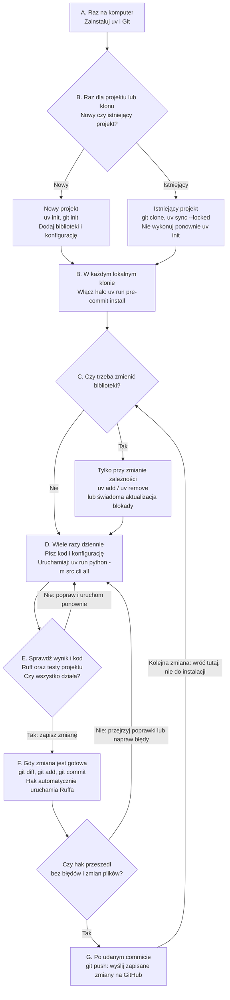

# Zajęcia 2. Powtarzalne środowisko i szkielet projektu

## Informacje podstawowe

- **Przedmiot:** Techniki MLOps
- **Czas:** 90 minut
- **Charakter zajęć:** wprowadzenie teoretyczne i ćwiczenie prowadzone
- **Tryb pracy:** indywidualny
- **Wymagania wstępne:** ukończone zajęcia 1, podstawy pracy w terminalu i z Git, konto na GitHubie
- **Środowisko:** notebook `gotowe_notebooki/zajecia_02.ipynb` uruchamiany z katalogu głównego repozytorium; `uv`, `ruff`, `git`
- **Rezultat:** mały projekt uruchamiany jedną komendą, z konfiguracją poza kodem, przypiętymi zależnościami i wysłany do zdalnego repozytorium

---

## Mapa pracy: kiedy używam którego narzędzia?

Zanim przejdziesz do szczegółów, potraktuj ten schemat jako mapę całych zajęć. **Nie wykonujemy wszystkich kroków od początku przy każdym uruchomieniu programu.** Przygotowanie komputera i projektu jest jednorazowe w danym miejscu, a później powtarzamy głównie pisanie, uruchamianie i sprawdzanie kodu.



**Jak czytać nazwy narzędzi na schemacie:**

| Narzędzie | Za co odpowiada? | Kiedy go używam? |
|---|---|---|
| `uv` | przygotowuje środowisko Pythona, zarządza bibliotekami i uruchamia w nim polecenia | przy przygotowaniu projektu, zmianie bibliotek i każdym uruchomieniu przez `uv run` — to ostatnie nie oznacza ponownej instalacji wszystkiego |
| `ruff` | sprawdza i formatuje kod; nie trenuje modelu i nie zapisuje historii | podczas pracy nad kodem oraz automatycznie przed commitem |
| `pre-commit` | łączy operację `git commit` z kontrolami, np. Ruffem | instalacja haka raz w każdym klonie; potem kontrole uruchamiają się automatycznie |
| `git` | zapisuje wybrane zmiany w lokalnej historii; wysyła je do zdalnego repozytorium | gdy chcemy zapisać gotową zmianę (`commit`) i ją udostępnić (`push`) |

**Częstotliwość w skrócie:** A — raz na komputer; B — raz dla nowego projektu lub każdego nowego klonu; C — tylko gdy zmieniamy biblioteki; D–E — wielokrotnie podczas pracy; F — dla każdej gotowej porcji zmian; G — po jednym lub kilku commitach, gdy chcemy je wysłać.

Schemat zakłada przygotowanie plików projektu i konfiguracji haka opisanych dalej. `uv init` nie napisze za nas potoku treningowego, a `pre-commit install` wymaga repozytorium Git i konfiguracji kontroli. `git commit` nie wysyła niczego na GitHub — robi to dopiero `git push`.

W trakcie lektury wracaj do oznaczeń: **B–C** rozwijają sekcje 3–4, **D** sekcje 5–7, **E–F** sekcja 8, a **G** sekcja 9. Na końcu dokumentu znajduje się **ściągawka A–G z poleceniami w kolejności użycia**.

## 1. Cele zajęć

Po zakończeniu zajęć student:

1. wyjaśnia, dlaczego notebook nie nadaje się na jedyną formę kodu w projekcie;
2. projektuje strukturę repozytorium oddzielającą kod, konfigurację, dane i artefakty;
3. przypina zależności i rozumie różnicę między deklaracją a plikiem blokady;
4. wyprowadza parametry z kodu do pliku konfiguracyjnego i zmiennych środowiskowych;
5. ustala ziarna losowości i zna granice powtarzalności;
6. uruchamia przygotowanie danych, trening i ewaluację jedną komendą;
7. włącza automatyczną kontrolę stylu i hak uruchamiany przed commitem;
8. zakłada zdalne repozytorium i wysyła do niego projekt.

## 2. Dlaczego notebook nie wystarcza

Notebook jest znakomitym narzędziem eksploracji i złym nośnikiem kodu produkcyjnego. Główne problemy:

- **Stan ukryty.** Wynik zależy od kolejności wykonania komórek, a nie od treści pliku. Ten sam notebook może dać dwa różne wyniki.
- **Brak jednostki wielokrotnego użytku.** Kodu z komórki nie da się zaimportować ani przetestować bez kopiowania.
- **Trudny przegląd zmian.** Różnice w formacie JSON zawierają wyniki i metadane, przez co przegląd kodu staje się nieczytelny.
- **Brak jawnego wejścia i wyjścia.** Nie wiadomo, jakie parametry przyjmuje eksperyment ani jakie artefakty wytwarza.
- **Brak sposobu uruchomienia bez człowieka.** Potok CI albo harmonogram potrzebują komendy, a nie instrukcji „uruchom wszystkie komórki”.

Notebook zostaje w projekcie, ale w roli **prezentacji wyników i eksploracji**, a nie implementacji.

> Zasada praktyczna: jeżeli fragment kodu ma zostać uruchomiony po raz drugi, powinien być funkcją w module, a nie komórką.

## 3. Struktura repozytorium projektu ML

Struktura ma czytelnie rozdzielać cztery rzeczy o różnym cyklu życia: kod, konfigurację, dane i artefakty.

```text
projekt/
├── config/
│   └── config.yaml          # parametry eksperymentu
├── data/                    # dane wejściowe (nie trafiają do Git)
├── src/
│   ├── config.py            # wczytanie konfiguracji
│   ├── pipeline.py          # prepare / train / evaluate
│   └── cli.py               # interfejs wiersza poleceń
├── artifacts/               # wyniki (nie trafiają do Git)
│   ├── models/
│   └── reports/
├── notebooks/               # eksploracja i prezentacja wyników
├── tests/
├── pyproject.toml           # opis projektu i deklaracja zależności
├── uv.lock                  # dokładne wersje zależności
├── .python-version          # wybrana wersja Pythona
├── Makefile                 # zadania projektowe
├── .gitignore
└── README.md
```

Reguły, które z tego wynikają:

- **kod** jest wersjonowany w Git i podlega przeglądowi;
- **konfiguracja** jest wersjonowana, ale zmienia się częściej niż kod;
- **dane** i **artefakty** nie trafiają do Git — są odtwarzalne albo przechowywane osobno;
- katalog wyników nigdy nie jest miejscem, z którego coś się importuje.

## 4. Zależności i przypinanie wersji

W tym przedmiocie do zarządzania środowiskiem Pythona używamy **`uv`**. Jest to narzędzie firmy Astral, uruchamiane z terminala, które pomaga:

- wybrać wersję Pythona i w razie potrzeby ją pobrać;
- utworzyć osobne środowisko dla projektu;
- dodawać i usuwać biblioteki;
- ustalać oraz zapisywać konkretne wersje zależności;
- uruchamiać program w tak przygotowanym środowisku.

`uv` nie jest biblioteką importowaną w kodzie ani zamiennikiem Pythona. Organizuje pracę z interpreterem i pakietami. Łączy w jednym przepływie pracy zadania, do których często używa się osobno `venv` (tworzenie środowiska) i `pip` (instalowanie pakietów), oraz obsługę pliku blokady.

### 4.1. Deklaracja a blokada zależności

Rozróżniamy dwa poziomy:

| Poziom | Co zawiera | Przykład |
|---|---|---|
| **Deklaracja** | biblioteki, których projekt faktycznie używa, wraz z dopuszczalnym zakresem wersji | `pyproject.toml`, `requirements.in` |
| **Blokada (lock)** | dokładne wersje **wszystkich** zależności, także pośrednich | `uv.lock`, `requirements.txt` z pełnym przypięciem |

**Deklaracja** to lista bezpośrednich zależności projektu: bibliotek, których kod używa wprost, oraz zakresów wersji, na które się zgadzamy. Przykładowo, jeśli program importuje `pandas`, w `pyproject.toml` możemy zapisać:

```toml
[project]
dependencies = [
    "pandas>=2.2,<3",
]
```

To znaczy: „projekt potrzebuje pandas w wersji co najmniej 2.2, ale jeszcze z głównej serii 2.x”. Nie wskazaliśmy jednej konkretnej wersji. Ponadto `pandas` samo korzysta z innych bibliotek, na przykład `numpy` i `python-dateutil`. Te zależności pośrednie nie muszą być wymienione w deklaracji, jeśli nasz kod ich bezpośrednio nie używa.

**Blokada** (plik lock) to wynik rozwiązania tych wymagań: konkretne wersje `pandas` i wszystkich potrzebnych mu zależności pośrednich. Dla powyższego przykładu mogłaby ustalić zestaw w rodzaju:

```text
pandas==2.2.3
numpy==2.1.3
python-dateutil==2.9.0.post0
six==1.16.0
```

To tylko uproszczona ilustracja — rzeczywisty plik blokady może zawierać więcej pakietów i dodatkowe informacje. Nie wybieramy ich ręcznie: narzędzie rozwiązuje zależności, sprawdza zgodność wersji i zapisuje wynik w `uv.lock` (albo, w innym przepływie pracy, w przypiętym `requirements.txt`).

W praktyce deklaracja odpowiada na pytanie **„jakie biblioteki i jakie wersje są dozwolone?”**, a blokada — **„jakie dokładnie wersje zainstalować, łącznie z zależnościami tych bibliotek?”**. Gdy współpracownik pobiera projekt i uruchamia `uv sync`, `uv` korzysta z `uv.lock`, aby odtworzyć zapisany zestaw, a nie wybierać na nowo dowolne wersje z dozwolonego zakresu. Gdy deklaracja się zmienia, blokadę trzeba też zaktualizować.

Bez blokady dwa środowiska mogą dostać różne wersje zależności — na przykład dlatego, że między instalacjami ukazało się nowsze wydanie mieszczące się w zadeklarowanym zakresie. Deklaracja opisuje więc intencję, a blokada pomaga odtworzyć konkretny zestaw.

Do przypięcia potrzebna jest jeszcze **wersja interpretera**. Kod działający na Pythonie 3.12 może nie działać na 3.14.

W tym przedmiocie ścieżką referencyjną jest `uv` z plikami `pyproject.toml`, `uv.lock` i `.python-version`. Wariant minimalny, wystarczający na ocenę 3,0, to `requirements.txt` z pełnym przypięciem oraz zapisana wersja Pythona.

### 4.2. Instalacja `uv`

`uv` instalujemy jako narzędzie na swoim komputerze, a nie jako zależność każdego projektu. Przykładowe metody instalacji:

**macOS z zainstalowanym Homebrew:**

```bash
brew install uv
```

**Windows z dostępnym WinGet (PowerShell):**

```powershell
winget install --id=astral-sh.uv -e
```

Dla Linuxa oraz komputerów bez tych menedżerów pakietów można skorzystać z instalatora opisanego w [oficjalnej instrukcji instalacji `uv`](https://docs.astral.sh/uv/getting-started/installation/). Wybieramy jedną metodę odpowiednią dla swojego systemu.

Po instalacji otwieramy nowy terminal i sprawdzamy:

```bash
uv --version
```

Polecenie powinno wypisać wersję narzędzia. Komunikat „command not found” lub „nie rozpoznano polecenia” oznacza, że instalacja albo dostępność `uv` w zmiennej `PATH` wymaga poprawienia — nie przechodzimy wtedy do następnych kroków.

### 4.3. Pierwszy projekt krok po kroku

Poniższe polecenia wykonujemy w terminalu. Tworzymy nowy katalog projektu z Pythonem 3.12, a następnie przechodzimy do niego:

```bash
uv init --python 3.12 moj-projekt-ml
cd moj-projekt-ml
```

`uv init` tworzy początkowe pliki projektu, w tym `pyproject.toml` i `.python-version`. Jeżeli projekt ma już swój katalog, zamiast tworzyć nowy można wejść do niego i wykonać `uv init --python 3.12`.

W notebooku kod, README i katalog projektu są już przygotowane, dlatego w sekcji 8 używamy `uv init --bare --name iris-projekt --python ">=3.12,<3.13" --vcs none --no-workspace`, a następnie `uv python pin 3.12`. Wariant `--bare` tworzy tylko `pyproject.toml`; pozostałe opcje pozostawiają konfigurację Gita do późniejszego ćwiczenia i zapobiegają dołączeniu do nadrzędnego workspace. Zakres wersji zachowuje wymaganie Pythona 3.12. Jeśli TOML już istnieje, pomijamy inicjalizację i nie nadpisujemy jego treści.

**Uwaga przy wyborze Pythona:** `uv python pin 3.12` zapisuje żądaną wersję, ale nie naprawia listy katalogów wyszukiwania programów (`PATH`). Podczas `uv add` narzędzie może natrafić na starą, niedziałającą instalację, np. Python 3.6 o niezgodnej architekturze na Macu z Apple Silicon. Komunikaty `Failed to inspect Python interpreter ... Versions/3.6/bin/python3` i `Bad CPU type in executable (os error 86)` wskazują wtedy na problem z interpreterem, nie z TOML. Doraźnie można podać pełną ścieżkę do działającego interpretera, np. `uv add --python /opt/homebrew/bin/python3.12 pandas` (przykład dla macOS z Homebrew na Apple Silicon i zainstalowanym Pythonem 3.12). Docelowo usuń wpis starego Pythona z konfiguracji `PATH`, np. z `~/.zprofile` w zsh, bez usuwania pozostałych wersji. Całkowicie zamknij i otwórz ponownie aplikację terminala oraz VS Code, jeśli korzystasz z terminala zintegrowanego — procesy mogą przechowywać stary `PATH`. Ponów nieudane `uv add`, nie inicjalizację projektu.

**VCS** (*Version Control System*) oznacza system kontroli wersji, np. Git, który pozwala zapisywać historię zmian plików w commitach. Opcja `--vcs` w `uv init` wybiera, czy narzędzie ma również zainicjalizować repozytorium: `--vcs git` zleca inicjalizację Gita dla nowego projektu (katalog `.git`, podobnie jak po `git init`), a `--vcs none` ją pomija. Nie jest to ustawienie wersji bibliotek ani Pythona. W notebooku pomijamy tę operację, aby później samodzielnie przećwiczyć `git init`, `git add` i `git commit`. Przy `--bare` brak inicjalizacji VCS jest już domyślny; jawne `--vcs none` podkreśla tę decyzję. Nie wyłącza ono ani nie usuwa istniejącego repozytorium, także nadrzędnego. Samo `--vcs git` nie tworzy commitów i niczego nie publikuje na GitHubie.

Dodajemy biblioteki:

```bash
uv add "pandas>=2.2,<3" scikit-learn
```

To polecenie wykonuje trzy powiązane czynności: zapisuje bezpośrednie zależności w `pyproject.toml`, rozwiązuje ich wymagania i zapisuje `uv.lock`, a następnie instaluje pakiety w środowisku projektu. Jeżeli środowisko jeszcze nie istnieje, `uv` tworzy katalog `.venv`. W razie potrzeby pobiera też odpowiedni interpreter Pythona.

**Nie prowadzimy osobnej listy instalacji z pamięci.** Gdy kod zaczyna używać biblioteki, instalujemy ją przez `uv add`, nie przez `pip install`. Dodajemy pakiety używane bezpośrednio przez projekt; zależności pośrednie dobiera narzędzie. Nazwa importu może różnić się od nazwy pakietu: `yaml` pochodzi z `PyYAML`, a `sklearn` z `scikit-learn`. Narzędzia programistyczne zapisujemy np. przez `uv add --dev pytest ruff`. Można podać samą nazwę (`uv add pandas`); `uv` domyślnie zapisze dolne ograniczenie na podstawie rozwiązanej wersji. Jawny zakres w przykładzie jest świadomą decyzją projektu, nie listą, którą trzeba odtworzyć z `pip freeze`.

Po `uv add` nie trzeba osobno wykonywać `uv lock` ani `uv sync`: deklaracja, blokada i środowisko są już uzgodnione. Ręczne tworzenie TOML pozostaje poprawną alternatywą, ale notebook uczy przepływu **inicjalizacja → dodawanie zależności → uruchomienie**, bez nadpisywania deklaracji gotowym szablonem.

**Środowisko wirtualne** to osobny interpreter wraz z pakietami dostępnymi dla projektu. Dzięki niemu jeden projekt może korzystać z innej wersji biblioteki niż drugi, bez zmieniania pakietów zainstalowanych globalnie na komputerze.

Uruchamiamy krótki test:

```bash
uv run python -c "import pandas; print(pandas.__version__)"
```

`uv run` uruchamia polecenie w środowisku projektu; przed uruchomieniem sprawdza i w razie potrzeby aktualizuje blokadę oraz środowisko. Nie trzeba osobno aktywować `.venv`. Własny plik uruchamiamy analogicznie: `uv run python main.py`, jeżeli plik `main.py` istnieje w projekcie.

**Ostrzeżenie o innym aktywnym środowisku:** notebook może korzystać z `.venv` repozytorium zajęć, podczas gdy projekt demonstracyjny ma własne `.venv` w swoim katalogu. Odziedziczone `VIRTUAL_ENV` może wtedy wywołać komunikat `does not match the project environment path ... and will be ignored`. Potok nadal może działać poprawnie: `uv` wybiera środowisko projektu. Nie stosujemy tu sugerowanego `--active`, ponieważ chcemy zachować izolację projektu od notebooka. W notebooku funkcja `project_environment` usuwa `VIRTUAL_ENV` z kopii środowiska przekazywanej do procesów `uv`, bez zmieniania środowiska jądra i bez ukrywania innych ostrzeżeń. W terminalu można wyłączyć wcześniej aktywowane obce środowisko przez `deactivate`, a następnie uruchomić polecenie przez `uv` w katalogu projektu.

### 4.4. Które pliki do czego służą?

| Plik lub katalog | Rola | Czy trafia do Git? |
|---|---|---|
| `pyproject.toml` | opis projektu, dopuszczalne wersje Pythona i deklaracja bezpośrednich zależności | tak |
| `uv.lock` | wygenerowane przez `uv` rozstrzygnięcie wersji zależności, także pośrednich; nie edytujemy go ręcznie | tak |
| `.python-version` | wersja Pythona wybierana lokalnie przez `uv`, w przykładzie `3.12` | tak |
| `.venv/` | lokalne środowisko z interpreterem i zainstalowanymi pakietami | nie; wpisujemy `.venv/` do `.gitignore` |

Zapis `3.12` wskazuje serię Pythona, a nie konkretną wersję poprawkową, taką jak `3.12.8`. Jeśli projekt wymaga również takiej dokładności, zapisujemy pełną wersję, np. poleceniem `uv python pin 3.12.8`. Sam lock zależności nie przypina interpretera ani nie gwarantuje identyczności systemu operacyjnego, sterowników czy sprzętu.

Po pobraniu istniejącego repozytorium **nie wykonujemy ponownie `uv init` ani nie dodajemy bibliotek od nowa**. Wchodzimy do katalogu zawierającego `pyproject.toml` i `uv.lock`, a następnie wykonujemy:

```bash
uv sync --locked
uv run --locked python -c "import pandas; print(pandas.__version__)"
```

`uv sync --locked` tworzy lokalne `.venv` i instaluje zależności zgodnie z blokadą. Opcja `--locked` wymaga, aby blokada już istniała i była zgodna z deklaracją: jeśli trzeba ją zmienić, polecenie zgłosi błąd zamiast zapisać nowy wynik. Ten sam tryb można zastosować do `uv run`, aby uruchomienie programu nie zmieniło blokady. To przydatne podczas odtwarzania eksperymentu i w CI.

### 4.5. Codzienna praca i aktualizacje

Najważniejsze polecenia wykonywane w katalogu projektu:

| Polecenie | Co robi |
|---|---|
| `uv init` | tworzy `pyproject.toml` i `.python-version` |
| `uv add pandas scikit-learn` | dodaje zależności do deklaracji, aktualizuje blokadę i środowisko |
| `uv remove pandas` | usuwa bezpośrednią zależność oraz aktualizuje blokadę i środowisko |
| `uv lock` | uzgadnia blokadę z deklaracją; zachowuje już zablokowane wersje, o ile nadal spełniają wymagania; nie instaluje pakietów |
| `uv sync` | uzgadnia blokadę z deklaracją i doprowadza środowisko do stanu opisanego w blokadzie |
| `uv sync --locked` | odtwarza środowisko, ale zgłasza błąd, jeśli blokada wymaga zmiany |
| `uv run python -m src.cli all` | uruchamia moduł projektu w tym środowisku, synchronizując je w razie potrzeby; wymaga wcześniej utworzonego `src/cli.py` |
| `uv lock --upgrade-package pandas` | żąda aktualizacji pandas w granicach deklaracji; w razie potrzeby zmienia też zależności pośrednie |

**Odtwarzanie środowiska i aktualizacja bibliotek to dwie różne operacje.** Jeśli chcemy powtórzyć poprzedni eksperyment, korzystamy z zapisanej blokady. Jeśli świadomie aktualizujemy bibliotekę, aktualizujemy blokadę, wykonujemy `uv sync`, uruchamiamy testy i dopiero potem zapisujemy zmiany w Git. Samo `uv lock` nie oznacza „zaktualizuj wszystko do najnowszych wersji”.

#### Przykład: co naprawdę zmieniają `lock`, `sync` i `sync --locked`?

W projekcie są trzy osobne rzeczy, które nie muszą być w danym momencie zgodne:

1. **Wymagania** w `pyproject.toml`: czego chcemy używać.
2. **Zapisany wybór wersji** w `uv.lock`: jakie konkretne wersje wybrało narzędzie.
3. **Zainstalowane pakiety** w `.venv`: co faktycznie jest dostępne dla programu.

Sama edycja pliku tekstowego nie instaluje ani nie aktualizuje żadnej biblioteki.

Załóżmy, że początkowo w `pyproject.toml` mamy:

```toml
[project]
dependencies = [
    "pandas>=2.2,<3",
]
```

W `uv.lock` zostało wcześniej wybrane `pandas 2.2.2` i ta sama wersja jest zainstalowana w `.venv`. Wszystko jest zgodne: wersja 2.2.2 mieści się w dozwolonym zakresie.

Teraz chcemy użyć dokładnie wersji 2.2.3. Na potrzeby przykładu **ręcznie zmieniamy tylko wpis w `pyproject.toml`**:

```toml
[project]
dependencies = [
    "pandas==2.2.3",
]
```

Po zapisaniu pliku mamy rozbieżność: deklaracja wymaga już 2.2.3, ale blokada i środowisko nadal zawierają 2.2.2. Poniższe trzy warianty to **alternatywne działania z tego samego stanu początkowego**, a nie polecenia do wykonania jedno po drugim. Zakładamy, że nową wersję i jej zależności da się poprawnie zainstalować w wybranym środowisku.

**Wariant A — `uv lock`: zmień zapisany wybór, ale jeszcze niczego nie instaluj.**

```bash
uv lock
```

`uv` odczytuje nowe wymaganie, ustala zgodne wersje pakietów i aktualizuje `uv.lock`. W blokadzie pojawia się `pandas 2.2.3`, ale w `.venv` nadal jest 2.2.2. To przydatne, gdy chcemy przygotować lub przejrzeć zmianę blokady przed instalacją. Aby następnie zainstalować wybrany zestaw, wykonujemy `uv sync`.

**Wariant B — `uv sync`: zmień zapisany wybór i zainstaluj go.**

```bash
uv sync
```

`uv` najpierw aktualizuje niezgodną blokadę do nowych wymagań, a potem aktualizuje pakiety w `.venv`. Po zakończeniu zarówno blokada, jak i środowisko wskazują `pandas 2.2.3`. Domyślnie usuwa też ze środowiska pakiety, które nie należą do synchronizowanego zestawu — nie tylko doinstalowuje brakujące.

**Wariant C — `uv sync --locked`: zainstaluj zapisany zestaw, ale nie pozwalaj zmieniać blokady.**

```bash
uv sync --locked
```

W naszym przykładzie polecenie **kończy się błędem**, ponieważ deklaracja wymaga 2.2.3, a blokada nadal wskazuje 2.2.2. Nie aktualizuje blokady ani nie przechodzi do instalowania pakietów. To celowe zabezpieczenie: „jeśli zapisany wybór nie pasuje do wymagań, zatrzymaj się zamiast ustalać nowy”.

Porównanie efektów dla tego przykładu:

| Wybrane działanie | Wymaganie w `pyproject.toml` | Wersja w `uv.lock` po poleceniu | Wersja w `.venv` po poleceniu |
|---|---|---|---|
| brak — tylko zapisaliśmy zmianę deklaracji | `pandas==2.2.3` | 2.2.2 | 2.2.2 |
| `uv lock` | `pandas==2.2.3` | 2.2.3 | 2.2.2 |
| `uv sync` | `pandas==2.2.3` | 2.2.3 | 2.2.3 |
| `uv sync --locked` | `pandas==2.2.3` | 2.2.2 — błąd, bez zmiany | 2.2.2 — bez aktualizacji pakietów |

**A kiedy `uv sync --locked` się powiedzie?** Na przykład gdy współpracownik pobierze repozytorium, w którym deklaracja i blokada są już zgodne: wymagają i wybierają 2.2.3. Nawet jeśli na jego komputerze nie ma jeszcze `.venv`, polecenie utworzy środowisko i zainstaluje zapisany zestaw. `--locked` nie zabrania instalowania pakietów — zabrania zmiany blokady.

**Czy każde `uv sync` pobiera najnowsze wersje?** Nie. Jeśli nie zmienimy początkowej deklaracji `pandas>=2.2,<3`, a blokada nadal poprawnie wybiera 2.2.2, samo opublikowanie nowszej wersji pandas nie spowoduje jej wyboru przez `uv lock` ani `uv sync`. Świadomej aktualizacji służy np. `uv lock --upgrade-package pandas`, a potem `uv sync`.

W codziennej pracy nie trzeba wykonywać ręcznie wszystkich tych kroków. Zamiast edytować deklarację jak w przykładzie, można użyć `uv add "pandas==2.2.3"` — to polecenie zmieni deklarację, blokadę i środowisko razem. Rozdzielenie kroków powyżej ma pokazać, że **plik z wymaganiami, plik z wybranymi wersjami i zainstalowane biblioteki to nie to samo**.

Więcej przykładów zawiera [oficjalny przewodnik pracy z projektami w `uv`](https://docs.astral.sh/uv/guides/projects/).

Rzędu wielkości warto sobie uświadomić od razu: sześć zadeklarowanych bibliotek to zwykle kilkadziesiąt pakietów w blokadzie. Te kilkadziesiąt to jest realna powierzchnia twojego projektu — zarówno pod względem powtarzalności, jak i bezpieczeństwa (wrócimy do tego na zajęciach 9).

> Pytanie kontrolne: czy potrafisz odtworzyć środowisko sprzed trzech miesięcy, mając wyłącznie zawartość repozytorium?

## 5. Konfiguracja poza kodem

Parametr zapisany w kodzie jest niewidoczny i trudny do zmiany bez modyfikacji programu. Wyprowadzenie parametrów do konfiguracji daje trzy rzeczy: jawność, możliwość porównywania eksperymentów i możliwość uruchomienia tego samego kodu w innym środowisku.

Obowiązuje prosta hierarchia źródeł, od najsłabszego do najsilniejszego:

1. wartość domyślna w kodzie;
2. plik konfiguracyjny w repozytorium;
3. zmienna środowiskowa;
4. argument wiersza poleceń.

Zmienne środowiskowe są jedynym właściwym miejscem na **sekrety**. Sekret nigdy nie trafia do pliku konfiguracyjnego w repozytorium ani do notebooka. Plik `.env` może istnieć lokalnie, ale musi znaleźć się w `.gitignore`.

Warto rozdzielić dwa rodzaje ustawień:

- **parametry eksperymentu** (ziarno, podział danych, hiperparametry) — należą do repozytorium, bo bez nich wynik jest nieodtwarzalny;
- **ustawienia środowiska** (adresy usług, ścieżki, poświadczenia) — należą do zmiennych środowiskowych, bo różnią się między komputerami.

## 6. Ziarna losowości i granice powtarzalności

Ziarno losowości ustala się wszędzie tam, gdzie występuje losowość: podział danych, inicjalizacja modelu, tasowanie, próbkowanie. Bez tego dwa uruchomienia tego samego kodu dają różne metryki i nie da się stwierdzić, czy zmiana wyniku to efekt poprawki, czy przypadku.

Ziarno nie rozwiązuje jednak wszystkiego. Powtarzalność ograniczają między innymi:

- inna wersja biblioteki lub interpretera;
- inna kolejność operacji przy przetwarzaniu równoległym;
- różnice w arytmetyce zmiennoprzecinkowej między procesorami i akceleratorami;
- zmiana danych wejściowych, o której nikt nie wie, bo dane nie są wersjonowane.

Dlatego mówimy o **powtarzalności warunkowej**: „ten sam kod, ta sama konfiguracja, te same dane i to samo środowisko dają ten sam wynik”. Każdy z tych czterech elementów musi być identyfikowalny — do danych wrócimy na zajęciach 3.

## 7. Jedna komenda uruchamiająca projekt

Projekt powinien mieć jawny, krótki interfejs uruchomieniowy. Może nim być zwykły skrypt Pythona przyjmujący argument określający etap:

```bash
python main.py --stage prepare
python main.py --stage train
python main.py --stage evaluate
python main.py --stage all
```

To poprawny sposób organizacji projektu, **jeśli w `main.py` zaimplementowaliśmy obsługę argumentu `--stage`**, np. za pomocą standardowej biblioteki `argparse`. Python sam nie zna znaczenia `--stage`: nasz kod odczytuje argument i wywołuje odpowiednią funkcję. Dla `all` powinien wykonać kolejno przygotowanie danych, trening i ewaluację.

Jeżeli środowiskiem zarządza `uv`, ten sam skrypt uruchamiamy przez `uv run`, np. `uv run python main.py --stage all`. Zmienia się sposób wyboru środowiska, nie znaczenie argumentów programu.

### Wariant używany na tych zajęciach

W projekcie z notebooka rolę skryptu wejściowego pełni `src/cli.py`, a etap jest argumentem pozycyjnym, czyli podawanym bez nazwy opcji `--stage`:

```bash
uv run python -m src.cli prepare     # przygotowanie danych
uv run python -m src.cli train       # trening modelu
uv run python -m src.cli evaluate    # ewaluacja i zapis metryk
uv run python -m src.cli all         # wszystkie trzy etapy po kolei
```

Polecenia wykonujemy z katalogu głównego projektu. `python -m src.cli` oznacza „uruchom moduł `cli` z katalogu/pakietu `src`”. Argument `all` jest odczytywany przez kod tego modułu. Jest to ten sam pomysł co `python main.py --stage all`, tylko z inną organizacją plików i składnią argumentów.

Pojedyncze etapy mogą wymagać wyników wcześniejszych: np. trening potrzebuje przygotowanych danych, a ewaluacja wytrenowanego modelu. Dlatego komenda `all` ma wykonywać całą sekwencję, także wtedy, gdy nie ma jeszcze wyników poprzedniego uruchomienia.

### Gdzie w tym wszystkim jest `make`?

**`make` jest osobnym programem, a nie poleceniem Pythona ani częścią `uv`.** Odczytuje zadania zapisane w pliku `Makefile` i wykonuje przypisane im polecenia. Wywodzi się z automatyzacji budowania programów, ale można go używać również jako zbioru krótkich nazw dla zadań projektowych.

Przykładowy `Makefile` może zawierać:

```makefile
.PHONY: prepare train evaluate all

prepare:
	uv run python -m src.cli prepare

train:
	uv run python -m src.cli train

evaluate:
	uv run python -m src.cli evaluate

all:
	uv run python -m src.cli all
```

Linie z poleceniami muszą zaczynać się znakiem **tabulacji**, a nie spacjami. Wpis `.PHONY` mówi, że te nazwy oznaczają zadania, a nie pliki, których istnienie mogłoby spowodować pominięcie polecenia.

Gdy wpiszemy `make train`, `make` znajdzie zadanie `train` i wykona `uv run python -m src.cli train`. **W tym przykładzie jest to tylko skrót** — logika treningu nadal znajduje się w Pythonie. Nazwa `all` również nie ma tu magicznego znaczenia: to nasz kod Pythona odpowiada za wykonanie wszystkich etapów.

`make` musi być osobno dostępne na komputerze; nie należy zakładać jego obecności, szczególnie w Windows. Jeżeli go nie ma albo nie chcemy go używać, wywołujemy bezpośrednio polecenia `uv run python ...` pokazane wyżej. Na tych zajęciach `Makefile` jest opcjonalnym ułatwieniem, a nie warunkiem uruchomienia projektu.

### Co jest rzeczywistym wymaganiem?

Zalety takiego podejścia:

- README nie musi opisywać sekwencji dziesięciu kroków;
- CI wywołuje dokładnie to samo, co człowiek;
- zmiana implementacji nie zmienia sposobu uruchomienia;
- łatwo sprawdzić, czy projekt działa po świeżym klonie.

Nie wymagamy konkretnego narzędzia do uruchamiania. Wymagamy, aby **istniała jedna udokumentowana komenda, która wykonuje całość**, np. `uv run python -m src.cli all` albo, w projekcie z innym interfejsem, `uv run python main.py --stage all`. `Makefile` może skrócić takie wywołanie, ale nie jest niezbędny.

## 8. Kontrola stylu i hak przed commitem

### Najpierw prosty obraz: kto co robi?

**Ruff to nazwa programu, który sprawdza i formatuje twój kod Pythona.** Nie piszemy osobnego „kodu Ruff” — piszemy zwykły kod Pythona, a Ruff go analizuje.

Załóżmy, że napisaliśmy:

```python
import math

wynik=2+3
print( wynik )
```

Ruff może wykryć, że import `math` nie jest używany, i usunąć go przy włączonej automatycznej naprawie. Formatter może następnie poprawić odstępy:

```python
wynik = 2 + 3
print(wynik)
```

Ruff nie sprawdzi natomiast, czy dodawanie jest właściwą operacją dla naszego zadania. **To kontroler wybranych problemów w kodzie i jego formatowania, a nie zamiennik testów ani oceny wyników modelu.**

**`pre-commit` jest organizatorem kontroli:** po odpowiednim skonfigurowaniu i włączeniu sprawia, że Ruff uruchamia się automatycznie przed zapisaniem commita. Nie trzeba wtedy pamiętać o ręcznym wywołaniu Ruffa za każdym razem.

```text
Wykonujesz git commit
        |
        v
Git uruchamia zainstalowany lokalnie hak
        |
        v
pre-commit odczytuje konfigurację kontroli
        |
        v
Ruff sprawdza i formatuje twój kod Pythona
        |
        v
Bez błędów i zmian plików: Git zapisuje commit
Błąd lub poprawione pliki: próba commita zostaje zatrzymana
```

W tym układzie **Git zapisuje historię, Ruff kontroluje kod, a `pre-commit` łączy te czynności**. `uv run` pozwala uruchomić narzędzie w środowisku projektu — samo nie decyduje, jakie kontrole wykonać.

### Ręczne uruchamianie Ruffa

Spór o formatowanie jest najtańszym sposobem na zmarnowanie czasu zespołu. Rozstrzyga się go raz, konfiguracją w repozytorium, i więcej do niego nie wraca.

`ruff` łączy dwie role: wykrywa błędy (nieużywane importy, przesłonięte nazwy, martwy kod) i formatuje kod. Konfiguracja należy do repozytorium — plik `ruff.toml` albo sekcja w `pyproject.toml`. Bez niej wynik zależy od wersji narzędzia zainstalowanej na danej maszynie.

```bash
ruff check src tests      # wykrywanie problemów
ruff check --fix src      # automatyczna naprawa części z nich
ruff format src tests     # formatowanie
```

### Automatyczne kontrole przed commitem

Drugi element to **hak uruchamiany przed commitem**. Hak (ang. *hook*) to program, który Git uruchamia automatycznie przy określonej operacji. Tutaj chcemy, aby przed zapisaniem commita Git sprawdził kod.

`pre-commit` jest osobnym narzędziem, które instaluje taki hak i zarządza uruchamianymi kontrolami. Nie należy go mylić z samym Ruffem: **Ruff sprawdza i formatuje kod, a `pre-commit` pilnuje, żeby został wywołany przed commitem**.

Poniższy fragment to **konfiguracja w formacie YAML**, a nie kod Pythona ani polecenia do wklejenia do terminala. Zapisujemy go w pliku `.pre-commit-config.yaml` w katalogu głównym projektu:

```yaml
repos:
  - repo: https://github.com/astral-sh/ruff-pre-commit
    rev: v0.16.6
    hooks:
      - id: ruff
        args: [--fix]
      - id: ruff-format
```

Poszczególne pola oznaczają:

| Pole | Znaczenie w tym przykładzie |
|---|---|
| `repos` | lista źródeł, z których `pre-commit` pobiera definicje kontroli |
| `repo` | adres repozytorium udostępniającego integrację Ruffa z `pre-commit`; nie jest to adres naszego projektu |
| `rev: v0.16.6` | konkretna wersja tej integracji; dzięki przypięciu nie pobieramy za każdym razem dowolnej najnowszej wersji |
| `hooks` | lista kontroli, które chcemy uruchamiać z tego źródła, w podanej kolejności |
| `id: ruff` | kontrola uruchamiająca `ruff check`, czyli wyszukiwanie problemów w kodzie; w tej wersji integracji `ruff` jest starszym aliasem nazwy `ruff-check` |
| `args: [--fix]` | dodatkowy argument przekazywany do tej kontroli: Ruff ma automatycznie naprawić problemy, które potrafi bezpiecznie poprawić; nie oznacza to, że naprawi każdy błąd |
| `id: ruff-format` | druga kontrola, uruchamiająca formatter; ujednolica zapis kodu, np. odstępy i łamanie linii |

W uproszczeniu konfiguracja mówi: **„przed commitem sprawdź kod Ruffem, popraw to, co się da, a następnie go sformatuj”**. Reguły analizy i formatowania nadal określamy w konfiguracji Ruffa, np. w `pyproject.toml`. Ten YAML określa, jakie kontrole uruchamiać, a nie zastępuje konfiguracji ich reguł.

`pre-commit` przygotowuje własne środowiska dla tych kontroli. Dlatego Ruff uruchamiany przez hak nie musi być tym samym programem co `ruff` dostępny globalnie w terminalu; jego wersja wynika tutaj z przypiętej integracji.

Dlaczego hak, skoro to samo zrobi CI? Bo koszt naprawy rośnie z odległością od miejsca powstania błędu. Hak kosztuje sekundy, przebieg CI — minuty, a wykrycie po scaleniu — cudzy czas.

### Jak włączyć kontrole?

W projekcie zarządzanym przez `uv` dodajemy narzędzie jako zależność programistyczną:

```bash
uv add --dev pre-commit
```

Po utworzeniu `.pre-commit-config.yaml`, w katalogu z już zainicjalizowanym repozytorium Git wykonujemy:

```bash
uv run pre-commit install
uv run pre-commit run --all-files
```

- `install` zapisuje lokalny hak w `.git/hooks/pre-commit`. Od tej chwili zwykłe `git commit` uruchamia kontrole automatycznie. Robimy to raz dla danego lokalnego klonu; sam plik YAML w repozytorium nie włącza haka na komputerach współpracowników.
- `run --all-files` uruchamia kontrole od razu na wszystkich pasujących plikach śledzonych przez Git, bez tworzenia commita. Pierwsze uruchomienie może potrwać dłużej, ponieważ narzędzie pobiera i przygotowuje środowiska kontroli.

**Co oznacza „raz w każdym lokalnym klonie”?** Klon to konkretna kopia repozytorium pobrana przez `git clone`. Jeżeli pobierzesz projekt na laptop i na drugi komputer, w obu kopiach osobno wykonujesz `uv run pre-commit install`. Tak samo, jeśli pobierzesz projekt do dwóch różnych katalogów na jednym komputerze. Jutro, gdy otworzysz ten sam katalog, nie wykonujesz instalacji haka ponownie.

Do repozytorium trafia `.pre-commit-config.yaml`, czyli **instrukcja, co sprawdzać**, ale lokalne podłączenie tej instrukcji do Gita nie jest kopiowane przez `git clone`. Git nie włącza automatycznie cudzych haków, ponieważ mogłyby wykonywać polecenia na twoim komputerze.

**Samo `uv run pre-commit install` nie sprawdza kodu Ruffem** — włącza mechanizm kontroli dla przyszłych commitów. Aby wykonać kontrole teraz, bez commita, służy osobne polecenie `uv run pre-commit run --all-files`. Jeśli haka nie zainstalujesz, projekt nadal może działać, ale zwykłe `git commit` nie uruchomi tych kontroli automatycznie.

### Co zobaczę podczas zwykłej pracy?

Załóżmy, że zmieniamy `src/pipeline.py`, dodając przypadkiem nieużywany import. Następnie:

```bash
git add src/pipeline.py
git commit -m "Dodanie treningu modelu"
```

Przed zapisaniem commita Git uruchomi hak. Domyślnie kontrole dostają pasujące pliki przygotowane do commita przez `git add`, a nie cały projekt. Ruff może usunąć nieużywany import, a formatter poprawić zapis kodu.

**Jeśli kontrola zmieni plik, ta próba commita zostanie przerwana**, nawet gdy problem został już automatycznie naprawiony. Narzędzie nie dodaje poprawek do commita za nas. Sprawdzamy zmiany, ponownie dodajemy plik i ponawiamy commit:

```bash
git diff -- src/pipeline.py
git add src/pipeline.py
git commit -m "Dodanie treningu modelu"
```

Jeżeli pozostaje błąd, którego Ruff nie potrafi naprawić automatycznie, trzeba go poprawić ręcznie. Gdy wszystkie kontrole przejdą i nie zmienią plików, Git zapisze commit. Te kontrole nie zastępują testów: poprawne formatowanie nie dowodzi, że model lub program działa prawidłowo.

Ważne: hak jest **wygodą, nie zabezpieczeniem**. Da się go pominąć (`git commit --no-verify`), więc te same kontrole muszą dziać się w CI, gdzie pominąć ich nie można.

## 9. Repozytorium zdalne

Projekt, który istnieje tylko na jednym dysku, nie jest projektem. Zdalne repozytorium daje trzy rzeczy: kopię, historię dostępną dla innych i miejsce, w którym później zamieszka potok CI.

```bash
git init
git add .
git commit -m "Szkielet projektu"
git branch -M main
git remote add origin https://github.com/<uzytkownik>/<projekt>.git
git push -u origin main
```

Zanim wykonasz pierwszy commit, sprawdź `.gitignore`. Cztery kategorie **nie mogą** trafić do repozytorium:

| Kategoria | Dlaczego |
|---|---|
| dane (`data/`) | rozmiar, licencje, dane osobowe; wersjonujemy je inaczej (zajęcia 3) |
| artefakty (`artifacts/`, `*.joblib`) | są odtwarzalne z kodu i danych; w Git tylko puchną |
| środowisko (`.venv/`, `__pycache__/`) | zależy od maszyny, odtwarzane z blokady |
| sekrety (`.env`) | raz opublikowany sekret jest sekretem spalonym |

Plik `uv.lock` **trafia** do repozytorium — bez niego blokada nie pełni swojej roli.

## 10. Ćwiczenie praktyczne

### Cel

Przekształcenie eksperymentu z zajęć 1 w mały projekt: struktura katalogów, konfiguracja w pliku YAML, moduły `config.py`, `pipeline.py` i `cli.py`, blokada zależności wygenerowana przez `uv`, kontrola stylu i uruchomienie całości jedną komendą.

Pracujesz z notebookiem `gotowe_notebooki/zajecia_02.ipynb`. W komórkach oznaczonych jako zadanie napisz kod samodzielnie; komórka poniżej zawiera rozwiązanie ukryte magią `%%skip True`. Zajrzyj do niego dopiero po własnej próbie.

Część dotycząca Gita i GitHuba wykonywana jest **poza notebookiem**, w terminalu — notebook przygotowuje pliki i sprawdza `.gitignore`, ale nie tworzy repozytorium za ciebie.

### Punkty kontrolne

Po przejściu notebooka wykonaj i opisz w komórce Markdown:

1. **Zmiana ziarna.** Ustaw zmienną środowiskową z innym ziarnem i uruchom potok ponownie. Które metryki się zmieniły i dlaczego?
2. **Deklaracja a blokada.** Porównaj liczbę bibliotek w `pyproject.toml` z liczbą pakietów w `uv.lock`. Skąd ta różnica i co z niej wynika?
3. **Usunięcie przypięcia.** Zamień w deklaracji jedno dokładne przypięcie na zakres i wyjaśnij, jakie ryzyko wprowadzasz.
4. **Świeży klon.** Usuń katalogi `data/` i `artifacts/` projektu demonstracyjnego, a następnie uruchom jedną komendę. Czy projekt się odbudował?

### Oczekiwana struktura artefaktów

```text
artifacts/
└── zajecia_02/
    └── projekt/
        ├── config/config.yaml
        ├── src/{config.py,pipeline.py,cli.py}
        ├── data/iris.csv
        ├── artifacts/models/model.joblib
        ├── artifacts/reports/metrics.json
        ├── pyproject.toml
        ├── uv.lock
        ├── .python-version
        ├── .pre-commit-config.yaml
        ├── .gitignore
        ├── Makefile
        └── README.md
```

### Co wymaga sprawdzenia przed zajęciami

- `uv --version`, `ruff --version`, `git --version` odpowiadają na maszynach studenckich;
- studenci mają konta na GitHubie i skonfigurowany sposób uwierzytelniania (klucz SSH albo token).

## 11. Zadanie projektowe (po zajęciach)

Załóż indywidualne repozytorium projektu zaliczeniowego i doprowadź je do stanu opisanego w kamieniu milowym po zajęciach 2:

- opisany problem, użytkownik systemu i metryka sukcesu w `README.md`;
- struktura katalogów rozdzielająca kod, konfigurację, dane i artefakty;
- przypięte zależności (`pyproject.toml` + `uv.lock`) oraz zapisana wersja Pythona;
- parametry eksperymentu w pliku konfiguracyjnym, nie w kodzie;
- ustalone ziarna losowości;
- jedna udokumentowana komenda uruchamiająca przygotowanie danych, trening i ewaluację;
- `.gitignore` wykluczający dane, artefakty, środowisko i pliki `.env`;
- konfiguracja `ruff` w repozytorium i zainstalowany hak `pre-commit`;
- **projekt wysłany na GitHub**, gotowy do sklonowania.

**Kryterium ukończenia:** inna osoba klonuje repozytorium, wykonuje instrukcję z `README.md` i otrzymuje plik z metrykami bez zadawania pytań.

## 12. Literatura

1. Python Packaging Authority, **Packaging Python Projects**:
   <https://packaging.python.org/en/latest/tutorials/packaging-projects/>
2. Astral, **uv — dokumentacja**:
   <https://docs.astral.sh/uv/>
3. Astral, **ruff — dokumentacja**:
   <https://docs.astral.sh/ruff/>
4. **pre-commit — dokumentacja**:
   <https://pre-commit.com/>
5. GitHub Docs, **Adding locally hosted code to GitHub**:
   <https://docs.github.com/en/migrations/importing-source-code/using-the-command-line-to-import-source-code/adding-locally-hosted-code-to-github>
6. Development Containers, **specyfikacja środowiska deweloperskiego**:
   <https://containers.dev/>
7. The Twelve-Factor App, **III. Config**:
   <https://12factor.net/config>
8. scikit-learn, **Controlling randomness**:
   <https://scikit-learn.org/stable/common_pitfalls.html#controlling-randomness>

## 13. Ściągawka A–G: od przygotowania do codziennej pracy

To instrukcja do mapy z początku dokumentu. **Nie wklejaj wszystkich bloków naraz:** wybierz odpowiednią ścieżkę w B, a potem wykonuj kroki zależnie od sytuacji. Polecenia projektowe uruchamiaj z katalogu zawierającego `pyproject.toml`. Nazwy katalogów i adresy z `<...>` zastąp własnymi.

### A. Przygotuj komputer — raz na komputer

Zainstaluj `uv` według sekcji 4.2 oraz Git według [instrukcji instalacji Gita](https://git-scm.com/book/en/v2/Getting-Started-Installing-Git). Sprawdź w terminalu:

```bash
uv --version
git --version
```

Oba polecenia muszą działać. Do wysyłania zmian potrzebujesz też konta na GitHubie i skonfigurowanego uwierzytelniania. Git wymaga ustawionej tożsamości autora commita (`user.name` i `user.email`).

Ruffa i `pre-commit` w poniższej ścieżce instalujemy w środowisku projektu, więc nie muszą być zainstalowane globalnie.

### B. Przygotuj projekt — wybierz jedną z dwóch ścieżek

#### B1. Zaczynasz zupełnie nowy projekt — raz dla tego projektu

Wykonuj w katalogu przeznaczonym na własne projekty, **nie wewnątrz istniejącego repozytorium zajęć**:

```bash
uv init --python 3.12 moj-projekt-ml
cd moj-projekt-ml
git init
uv add pandas scikit-learn pyyaml joblib
uv add --dev "ruff==0.16.6" pre-commit
```

`uv init` przygotowuje szkielet projektu, `git init` inicjalizuje lokalną historię, a `uv add` zapisuje wymagania i instaluje biblioteki. Zależności z `--dev` służą do pracy nad projektem, a nie do samego uruchamiania modelu. Wersja Ruffa w tym przykładzie odpowiada wersji integracji z sekcji 8, aby kontrole ręczne i hak korzystały z tej samej wersji.

**Teraz przygotuj pliki — same polecenia powyżej nie tworzą działającego projektu ML:**

1. Utwórz kod `src/config.py`, `src/pipeline.py`, `src/cli.py` i konfigurację `config/config.yaml` według ćwiczenia w notebooku.
2. Zapisz reguły Ruffa w `pyproject.toml` albo `ruff.toml`.
3. Utwórz `.pre-commit-config.yaml` z sekcji 8.
4. Sprawdź `.gitignore`: musi wykluczać `.venv/`, dane, artefakty i sekrety.
5. W `README.md` zapisz sposób uruchamiania i miejsce zapisu wyników.

Jeżeli notebook już wygenerował projekt demonstracyjny, **nie wykonuj w nim ponownie `uv init`**. Wejdź do wygenerowanego katalogu projektu, sprawdź istniejące pliki, zainicjalizuj Git, jeśli jeszcze go nie ma, i przygotuj środowisko przez `uv sync --locked`.

#### B2. Pobierasz istniejący projekt — raz dla każdego nowego klonu

Zamiast B1 wykonaj:

```bash
git clone https://github.com/<uzytkownik>/<projekt>.git moj-projekt-ml
cd moj-projekt-ml
uv sync --locked
```

Ta ścieżka zakłada, że repozytorium zawiera już deklarację, aktualną blokadę oraz konfigurację narzędzi programistycznych. `uv sync --locked` instaluje również domyślną grupę zależności programistycznych. **Nie dodawaj ponownie tych samych bibliotek przez `uv add`.** Jeśli blokada jest niezgodna z deklaracją, wyjaśnij rozbieżność zamiast automatycznie aktualizować ją podczas odtwarzania środowiska.

#### B3. Włącz hak — raz w każdym lokalnym klonie

Po B1 lub B2:

```bash
uv run pre-commit install
```

To połączenie lokalnego Gita z konfiguracją kontroli. Nie trzeba powtarzać go przed każdym commitem. Na nowym komputerze lub po kolejnym `git clone` wykonaj je ponownie.

### C. Zmień biblioteki — tylko gdy jest taka potrzeba

Jeżeli niczego nie dodajesz, nie usuwasz i nie aktualizujesz, **pomiń ten etap i przejdź do D**.

| Sytuacja | Polecenia w kolejności | Co się zmieni? |
|---|---|---|
| kod zaczyna używać nowej biblioteki, np. do wykresów | `uv add matplotlib` | deklaracja, blokada i środowisko |
| projekt przestaje potrzebować bezpośredniej zależności | `uv remove matplotlib` | deklaracja, blokada i środowisko; pakiet może pozostać, jeśli wymaga go inna biblioteka |
| chcesz świadomie zaktualizować pandas w dozwolonym zakresie | `uv lock --upgrade-package pandas`, następnie `uv sync` | blokada, potem środowisko; zakres w deklaracji pozostaje bez zmian |
| ręcznie zmieniłeś wymagania w `pyproject.toml` | `uv lock`, następnie `uv sync` | najpierw zapis wybranych wersji, potem instalacja; samo `uv sync` może wykonać oba kroki |
| pobrałeś cudze zmiany deklaracji i blokady | `uv sync --locked` | lokalne środowisko; bez zmiany zapisanej blokady |

Po zmianie bibliotek przejdź przez D–F: uruchom projekt, sprawdź wyniki i zapisz zmienione pliki zależności razem z kodem. Nie traktuj aktualizacji bibliotek jako obowiązkowego początku każdej sesji.

### D. Pisz i uruchamiaj kod — wiele razy podczas pracy

Po edycji kodu lub konfiguracji uruchom cały potok:

```bash
uv run python -m src.cli all
```

Albo wybrany etap, gdy masz już wymagane wyniki wcześniejszych etapów:

```bash
uv run python -m src.cli prepare
uv run python -m src.cli train
uv run python -m src.cli evaluate
```

Te polecenia wymagają gotowego interfejsu `src/cli.py` z ćwiczenia. Jeżeli świadomie zaprojektowałeś wejście jako `main.py --stage`, używaj zamiast nich np. `uv run python main.py --stage all`.

Sprawdź, czy powstały oczekiwane wyniki, m.in. model i raport metryk. W razie błędu popraw kod lub konfigurację i uruchom ponownie. Nie potrzebujesz commita po każdym uruchomieniu ani `uv add`, jeśli nie zmieniają się zależności.

### E. Sprawdź kod — podczas pracy i przed commitem

W projekcie z katalogiem `src`:

```bash
uv run ruff check src
uv run ruff format --check src
```

Pierwsze polecenie zgłasza problemy wykrywane przez linter, drugie sprawdza formatowanie bez zmieniania plików. Jeśli chcesz zastosować automatyczne poprawki:

```bash
uv run ruff check --fix src
uv run ruff format src
git diff
```

Przejrzyj zmiany, popraw pozostałe błędy ręcznie i powtórz kontrole. Jeśli projekt ma testy, uruchom również polecenie testowe opisane w jego `README.md`; sam Ruff ani poprawne uruchomienie treningu nie zastępują testów.

Możesz też sprawdzić cały zestaw kontroli haka bez tworzenia commita:

```bash
uv run pre-commit run --all-files
```

To obejmuje pasujące pliki śledzone przez Git. W zupełnie nowym repozytorium najpierw trzeba dodać pliki do śledzenia w kroku F — inaczej ta kontrola nie obejmie jeszcze nowych plików.

### F. Zapisz gotową zmianę — dla każdej logicznej porcji pracy

Najpierw zobacz, co się zmieniło:

```bash
git status
git diff
```

Po sprawdzeniu `.gitignore` i upewnieniu się, że nie dodasz danych, modeli ani sekretów, przygotuj pliki do commita:

```bash
git add .
git diff --cached
git commit -m "Dodanie powtarzalnego potoku treningowego"
```

`git add .` obejmuje wszystkie nieignorowane zmiany pod bieżącym katalogiem. Jeśli nie wszystkie należą do tej zmiany, zamiast niego użyj `git add` z konkretnymi ścieżkami. `git diff --cached` pokazuje dokładnie to, co zamierzasz zapisać.

Podczas `git commit` hak uruchomi kontrole automatycznie:

- **kontrole przechodzą bez zmian plików:** commit zostaje zapisany lokalnie;
- **kontrola poprawiła plik:** przejrzyj `git diff`, ponownie wykonaj `git add` dla poprawionych plików i ponów commit;
- **kontrola zgłosiła nienaprawiony błąd:** wróć do D–E, popraw problem, ponownie dodaj pliki i ponów commit.

Do historii trafiają kod i konfiguracja, w tym `pyproject.toml`, `uv.lock`, `.python-version` i `.pre-commit-config.yaml`. Zainstalowane środowisko `.venv` nie trafia do historii.

### G. Wyślij commity — gdy chcesz udostępnić zapisane zmiany

**Pierwsza publikacja własnego nowego projektu:** utwórz puste repozytorium na GitHubie, bez automatycznego dodawania plików. Po udanym pierwszym commicie wykonaj:

```bash
git branch -M main
git remote add origin https://github.com/<uzytkownik>/<projekt>.git
git push -u origin main
```

Te trzy polecenia dotyczą ścieżki B1, gdy nie skonfigurowałeś jeszcze zdalnego repozytorium. Po `git clone` adres `origin` już istnieje — nie dodawaj go ponownie.

**Kolejne wysłanie commitów na gałęzi z ustawionym śledzeniem:**

```bash
git push
```

Jeżeli nie masz uprawnień do repozytorium źródłowego, potrzebujesz uzgodnionej ścieżki współpracy, np. własnego forka. Jeżeli wysyłanie zostanie odrzucone z powodu cudzych zmian, najpierw uzgodnij i zintegruj historię; nie rozwiązuj tego wymuszonym nadpisaniem zdalnej gałęzi.

Po wysłaniu wróć do **C tylko przy zmianie bibliotek**, a zwykle bezpośrednio do **D: edytuj → uruchom → sprawdź**. Przy następnym otwarciu tego samego projektu nie wykonuj ponownie instalacji narzędzi, `uv init`, `git init` ani instalacji haka.
