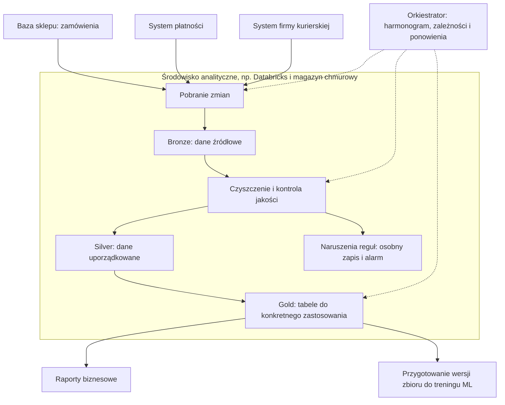

# Zajęcia 3. Dane: wersjonowanie, kontrakt i governance

## Informacje podstawowe

- **Przedmiot:** Techniki MLOps
- **Czas:** 90 minut
- **Charakter zajęć:** wprowadzenie teoretyczne i ćwiczenie prowadzone
- **Tryb pracy:** indywidualny
- **Wymagania wstępne:** ukończone zajęcia 2, własne repozytorium projektu
- **Środowisko:** notebook `gotowe_notebooki/zajecia_03.ipynb` uruchamiany z katalogu głównego repozytorium; wymagany dostęp do sieci i `dvc`
- **Rezultat:** dane pobrane ze źródła i objęte kontrolą wersji, manifest z sumą kontrolną, schemat kontraktu, raport walidacji i metryczka pochodzenia

---

## 1. Cele zajęć

Po zakończeniu zajęć student:

1. wyjaśnia, dlaczego wersjonowanie kodu nie wystarcza do odtworzenia wyniku;
2. pobiera dane ze źródła skryptem i tworzy manifest z sumą kontrolną;
3. obejmuje dane kontrolą wersji przy użyciu DVC i odtwarza je po skasowaniu;
4. definiuje kontrakt danych i automatycznie go weryfikuje;
5. rozpoznaje trzy typowe rodzaje wycieku danych;
6. ocenia jakość etykiet jako górną granicę jakości modelu;
7. dokumentuje pochodzenie, licencję i ograniczenia użycia zbioru;
8. wyjaśnia rolę platformy danych, pipeline'u i inżyniera danych w dużej organizacji.

## 2. Trzy rzeczy, które trzeba wersjonować

Git wersjonuje kod. To za mało, ponieważ wynik modelu zależy od trzech niezależnie zmieniających się elementów:

| Co | Zmienia się | Typowy mechanizm |
|---|---|---|
| **Kod** | przy każdej zmianie logiki | Git |
| **Dane** | poza repozytorium, często bez powiadomienia | manifest z sumą kontrolną albo DVC |
| **Metadane przebiegu** | przy każdym uruchomieniu | narzędzie do śledzenia eksperymentów (zajęcia 5) |

Rozważmy przykład: trenujesz model, który rozpoznaje spam. Skrypt odczytuje wiadomości i ich etykiety („spam” lub „nie spam”) z pliku `data/train.csv`. Ten plik nazywamy **plikiem wejściowym**, ponieważ dostarcza dane do treningu. Załóżmy, że nie zapisujesz go w Git i nie śledzisz jego wersji w żaden inny sposób.

1. **Pierwszy trening.** Plik zawiera 10 tysięcy oznaczonych wiadomości. Trenujesz model i sprawdzasz go na osobnym zbiorze testowym. Model poprawnie klasyfikuje 91% wiadomości testowych. Zapisujesz wynik i commit kodu, którym go uzyskałeś.
2. **Zmiana danych.** Tydzień później pobierasz nowy eksport wiadomości i zapisujesz go w miejsce poprzedniego pliku `data/train.csv`. Nazwa i kolumny są takie same, ale zawartość jest inna: eksport obejmuje teraz tylko ostatni miesiąc, czyli 6 tysięcy wiadomości. Poprzednia zawartość pliku zostaje nadpisana.
3. **Ponowny trening.** Uruchamiasz ten sam kod, z tymi samymi ustawieniami i ustalonym ziarnem losowości, w tym samym środowisku. Skrypt odczytuje nowy plik bez błędu — kolumny nadal pasują. Model uczy się jednak na innych przykładach. Na niezmienionym zbiorze testowym może teraz uzyskać np. 86% poprawnych odpowiedzi.
4. **Próba wyjaśnienia różnicy.** Sprawdzasz historię Git: kod się nie zmienił. Nie znajdziesz w niej jednak zmiany danych, bo plik nie był objęty kontrolą wersji. Sam zapis „użyto `data/train.csv`” nie pozwala ustalić, jakie wiadomości posłużyły do pierwszego treningu ani odzyskać poprzedniego zbioru.

W tym sensie dane zmieniły się **„po cichu”**: ich podmiana nie spowodowała błędu odczytu ani nie zostawiła śladu w historii Git. **Ta sama nazwa pliku nie oznacza tej samej zawartości, a ten sam commit kodu nie wystarcza do odtworzenia wyniku.** Dlatego przy każdym treningu trzeba zapisać również informację pozwalającą jednoznacznie wskazać używaną wersję danych.

Duże pliki nie powinny trafiać do Git — historia repozytorium rośnie nieodwracalnie. Dla plików, z którymi pracujemy na tych zajęciach, rozważymy dwa warianty:

- **Manifest** — plik JSON w repozytorium z adresem źródła, wersją i sumą kontrolną. Dane pobiera skrypt. Wariant minimalny, wystarczający dla większości projektów studenckich.
- **DVC (Data Version Control, kontrola wersji danych) lub odpowiednik** — narzędzie przechowujące dane w magazynie zdalnym i wersjonujące je równolegle do Git. Wariant właściwy, gdy dane zmieniają się często albo są duże.

W obu przypadkach kluczowa jest **suma kontrolna**. Bez niej nie wiadomo, czy plik pod tym samym adresem to nadal ten sam plik.

## 3. Jak działa DVC

DVC rozdziela dwie rzeczy, które Git łączy: **wskaźnik** i **zawartość**.

```text
repozytorium Git              magazyn DVC (S3, dysk, SSH)
  data/surowe.csv.dvc   ───▶   obiekt o sumie 9cc1c345…
  (kilkaset bajtów)             (właściwy plik, dowolnie duży)
```

Plik `.dvc` zawiera sumę kontrolną, rozmiar i ścieżkę — i to on podlega przeglądowi kodu oraz historii Git. Sam plik danych trafia do `.gitignore`, dopisywany tam automatycznie przez `dvc add`.

Cztery polecenia wystarczają do pełnego cyklu:

| Polecenie | Co robi |
|---|---|
| `dvc init` | tworzy katalog `.dvc` wewnątrz repozytorium Git |
| `dvc add data/surowe.csv` | przenosi plik do pamięci podręcznej i tworzy wskaźnik |
| `dvc remote add -d magazyn <adres>` | wskazuje magazyn zdalny |
| `dvc push` / `dvc pull` | wysyła zawartość do magazynu i pobiera ją z powrotem |

Sprawdzianem poprawności jest **świeży klon**: `git clone` plus `dvc pull` musi dać komplet danych. Jeżeli na tym etapie ktoś musi przesłać plik ręcznie, wersjonowanie nie działa.

Poświadczenia do magazynu **nie są wersjonowane** — trafiają do `.dvc/config.local`, który DVC sam dopisuje do `.gitignore`.

## 4. Jak wygląda to w dużej firmie

### 4.1. Od pojedynczego pliku do wielu źródeł danych

W ćwiczeniu jeden student pobiera jeden plik. W dużej firmie dane powstają cały czas, w wielu systemach, a korzystają z nich różne zespoły. Zasady pozostają jednak te same: trzeba wiedzieć, skąd pochodzą dane, sprawdzić ich jakość i umieć wskazać wersję użytą do obliczeń.

Wyobraź sobie sklep internetowy. Zamówienia są zapisywane w bazie sklepu, płatności obsługuje osobny system, a informacje o przesyłkach dostarcza firma kurierska. Dział finansowy chce policzyć przychód, a zespół ML — zbudować model przewidujący opóźnienia dostaw. Żaden z tych zespołów nie dostaje od razu jednej gotowej tabeli: dane trzeba pobrać, połączyć po numerze zamówienia i sprawdzić.

Nie chcemy też, żeby każde obliczenie analityczne odpytywało bazę obsługującą zakupy klientów. Ciężkie zapytanie mogłoby spowolnić sklep. Dlatego dane zwykle przenosi się do osobnego środowiska analitycznego, z kontrolą obciążenia źródeł i dostępu do danych.

### 4.2. Baza danych, chmura i Databricks — różne role

Te nazwy nie oznaczają trzech wzajemnie wykluczających się sposobów przechowywania danych. Mogą opisywać elementy tego samego rozwiązania:

| Element | Do czego służy | Przykład w sklepie |
|---|---|---|
| **Baza operacyjna**, np. PostgreSQL | obsługuje bieżącą pracę aplikacji: zapis i zmianę pojedynczych rekordów | zapisuje nowe zamówienie i jego status |
| **Magazyn obiektowy**, np. Amazon S3 lub Azure Data Lake Storage | przechowuje duże ilości plików, także tych, które składają się na tabele analityczne | przechowuje kopie danych o zamówieniach i przesyłkach |
| **Hurtownia danych**, np. BigQuery lub Snowflake | udostępnia uporządkowane dane do analiz, zwykle przez SQL — język zapytań do tabel | pozwala obliczyć przychód według miesiąca i kraju |
| **Platforma danych**, np. Databricks | łączy narzędzia do przetwarzania danych, pracy z tabelami, analiz i ML | uruchamia przygotowanie danych i udostępnia wynik zespołowi ML |

**Chmura** to sposób udostępniania zasobów: zamiast utrzymywać wszystkie serwery samodzielnie, firma korzysta z usług dostawcy, np. AWS, Azure lub Google Cloud. W chmurze mogą działać zarówno bazy operacyjne, jak i magazyny plików oraz platformy analityczne.

Databricks nie jest po prostu „dyskiem na dane”. W typowym rozwiązaniu korzysta z plików w magazynie chmurowym, udostępnia je jako tabele i zapewnia zasoby obliczeniowe do ich przetwarzania. Często używa się przy tym **Delta Lake** — formatu tabel, który dodaje m.in. kontrolowane zapisy i historię wersji. Połączenie magazynu plików z możliwościami kojarzonymi z hurtownią nazywa się **lakehouse**. Nie trzeba zapamiętywać wszystkich nazw: najważniejsze jest rozróżnienie **miejsca przechowywania danych** od **narzędzi, które je przetwarzają**. Produkty mogą łączyć kilka tych ról.

### 4.3. Czym jest pipeline

**Pipeline**, po polsku **potok**, to zautomatyzowany proces złożony z kroków, które prowadzą od danych źródłowych do wyniku gotowego do użycia. Nie jest nazwą konkretnego programu. Prosty pipeline może być skryptem, a duży — zestawem zadań wykonywanych przez wiele usług.

W naszym sklepie codzienny pipeline mógłby wyglądać tak:

1. **Pobierz zmiany** w zamówieniach, płatnościach i przesyłkach od poprzedniego udanego pobrania.
2. **Zapisz dane źródłowe** w wydzielonej warstwie, zanim zastosujesz reguły czyszczenia. Ułatwi to późniejsze wyjaśnienie błędów.
3. **Uporządkuj i sprawdź dane:** ujednolić trzeba np. format dat, usunąć powtórzenia i sprawdzić, czy każde zamówienie ma identyfikator. Niepoprawne rekordy należy odseparować i zaraportować, a nie po cichu zgubić.
4. **Połącz dane i przygotuj tabele**, np. jedną tabelę zawierającą dla każdego zamówienia kwotę, datę wysyłki i datę doręczenia.
5. **Udostępnij wynik** uprawnionym odbiorcom: raportom i zespołowi przygotowującemu zbiór do treningu modelu.

Popularny podział na warstwy **bronze, silver i gold** odpowiada w przybliżeniu danym źródłowym, oczyszczonym i przygotowanym do konkretnego zastosowania. To konwencja organizacyjna, nie obowiązkowa funkcja każdej platformy.



Strzałki ciągłe pokazują przepływ danych. Przerywane pokazują sterowanie: **orkiestrator**, np. Apache Airflow albo mechanizm zadań w Databricks, pilnuje, kiedy uruchomić kroki i w jakiej kolejności. Jeśli pobranie danych się nie powiedzie, nie powinien opublikować starego wyniku jako nowego. Powinien zgłosić problem i, jeśli błąd jest przejściowy, ponowić próbę.

Nie każdy pipeline działa raz dziennie. Przetwarzanie **wsadowe** obsługuje porcję danych, np. co noc, a **strumieniowe** przetwarza napływające zdarzenia na bieżąco. Dla nocnego raportu wystarczy zwykle pierwsze podejście; wykrywanie podejrzanych płatności może wymagać drugiego.

### 4.4. Na czym polega praca inżyniera danych

**Inżynier danych (Data Engineer)** buduje i utrzymuje drogę od systemów źródłowych do danych, z których inni mogą bezpiecznie korzystać. Duża część tej pracy to nie trenowanie modeli, lecz zapewnianie, że dane dotrą na czas, będą zrozumiałe i nie zmienią znaczenia bez ostrzeżenia.

W przykładzie sklepu inżynier danych:

- ustala z właścicielami systemów, jak pobierać dane i co oznaczają pola — np. czy „kwota zamówienia” uwzględnia zwroty;
- pisze kod pobierający, czyszczący i łączący dane oraz testy tych operacji;
- organizuje tabele tak, żeby można było sprawnie odczytać potrzebny zakres, bez niepotrzebnego przetwarzania całej historii;
- konfiguruje harmonogramy, monitoruje opóźnienia i reaguje na awarie;
- dba, żeby ponowienie zadania nie dopisało drugi raz tych samych zamówień, oraz umożliwia przeliczenie danych historycznych po poprawieniu błędu;
- współpracuje przy nadawaniu uprawnień, ochronie danych osobowych i dokumentowaniu pochodzenia tabel.

Przykładowy poranek: tabela przesyłek nie została zaktualizowana, bo dostawca zmienił nazwę kolumny. Inżynier sprawdza komunikat błędu, uzgadnia zmianę, poprawia kod i testy, a następnie ponownie przetwarza brakujący okres. Dopiero po sprawdzeniu wyniku udostępnia aktualne dane odbiorcom.

| Zadanie | Przykładowe narzędzia |
|---|---|
| Odczyt, łączenie i przekształcanie tabel | SQL, Python; Apache Spark przy przetwarzaniu rozłożonym na wiele maszyn |
| Zarządzanie przekształceniami zapisanymi w SQL | dbt |
| Planowanie zadań i pilnowanie ich zależności | Apache Airflow, zadania w Databricks |
| Przechowywanie i udostępnianie danych | PostgreSQL, S3, Azure Data Lake Storage, BigQuery, Snowflake, Databricks z Delta Lake |
| Testy, przegląd i historia zmian kodu | Git, pytest, testy danych w dbt |
| Katalog danych, uprawnienia i pochodzenie tabel | np. Unity Catalog w Databricks |

To przykłady, nie lista narzędzi wymaganych w każdej firmie. Zespół dobiera zestaw do swoich potrzeb. Inżynier danych odpowiada przede wszystkim za niezawodność dopływu danych; analityk za ich interpretację, a specjalista ML za budowę i ocenę modelu. W praktyce te role częściowo się przenikają.

### 4.5. Kto może korzystać z danych i skąd wiadomo, co oznaczają

Wspólna platforma nie oznacza, że każdy pracownik widzi wszystko. **Governance danych** to zasady i odpowiedzialności dotyczące danych: kto jest właścicielem tabeli, kto może ją odczytać, do czego wolno jej używać i jak długo można ją przechowywać.

Pomaga w tym **katalog danych** — rodzaj firmowego spisu tabel z opisami i właścicielami. Z kolei **lineage**, czyli informacja o pochodzeniu i przepływie danych, pokazuje np., że tabela do treningu powstała z tabel zamówień i przesyłek. Dzięki temu po wykryciu błędu w źródle można ustalić, które raporty i modele mogły z niego skorzystać. Dostęp do nazwisk czy adresów klientów powinien być ograniczony niezależnie od tego, kto ma dostęp do statystyk sprzedaży.

### 4.6. Co zastępuje plik `.dvc` w świecie tabel

Nie trzeba eksportować każdej firmowej tabeli do CSV i dodawać jej do DVC. Platformy mogą mieć własne mechanizmy wersjonowania. Na przykład tabela Delta Lake ma numerowane wersje, a odczyt starszej wersji nazywa się **time travel**.

Przy treningu można więc zapisać: „tabela `zamowienia`, wersja 42; tabela `przesylki`, wersja 17”, a oprócz tego kod zapytania, jego parametry, commit kodu i ustawienia środowiska. Sam zapis „pobrano dane we wtorek” nie wystarcza. Jeśli zbiór powstaje z kilku tabel, trzeba wskazać wersję każdej z nich i zadbać o ich spójność, np. wspólny zakres dat.

**Historia tabeli nie jest bezterminową kopią zapasową.** Odczyt dawnej wersji jest możliwy tylko tak długo, jak przechowywane są potrzebne pliki i metadane. Firma musi ustalić okres ich zachowania albo utrwalić osobny zbiór treningowy zgodnie z zasadami bezpieczeństwa i retencji. W zwykłej bazie bez historii wersji także trzeba zaplanować taki mechanizm — samo zapisanie zapytania SQL nie odtworzy starych wartości po ich nadpisaniu.

**Zmieniają się narzędzia, ale nie cel:** dla każdego wyniku chcemy wiedzieć, jakim kodem i na jakich dokładnie danych go uzyskano. DVC pokazuje tę zasadę na plikach; historia tabel i kontrolowane zbiory treningowe realizują ją w środowisku platform danych.

## 5. Kontrakt danych

Kontrakt danych to jawna, wykonywalna deklaracja tego, czego kod oczekuje od wejścia. Zawiera co najmniej:

- **zbiór kolumn** — także informację, że kolumn nadmiarowych być nie może;
- **typy** — z rozróżnieniem liczby, kategorii, tekstu i daty;
- **zakresy i wartości dopuszczalne** — np. wiek z przedziału 0–120, kategoria z zamkniętej listy;
- **dopuszczalność braków** — osobno dla każdej kolumny;
- **niezmienniki na poziomie zbioru** — np. minimalna liczba wierszy, unikalność klucza, rozsądny udział klas.

Kontrakt pełni trzy funkcje naraz: jest dokumentacją, testem i sygnałem alarmowym po wdrożeniu. Jego złamanie oznacza, że **zmieniło się źródło danych**, a nie że kod ma błąd. To zupełnie inna klasa incydentu i wymaga innej reakcji.

> Ta sama definicja schematu powinna działać na danych treningowych i na żądaniach przychodzących do usługi. Do tego wrócimy na zajęciach 8.

Warto rozróżnić dwa pytania, które łatwo pomylić:

| Pytanie | Odpowiada | Kiedy sygnalizuje problem |
|---|---|---|
| Czy to **ten sam plik**? | suma kontrolna | gdy ktoś podmienił dane bez uprzedzenia |
| Czy to **sensowne dane**? | kontrakt | gdy zmieniło się źródło albo sposób ich wytwarzania |

Nowa dostawa danych **ma** mieć inną sumę kontrolną, ale **musi** spełniać ten sam kontrakt. Mylenie tych dwóch kontroli prowadzi albo do fałszywych alarmów przy każdej aktualizacji, albo do przepuszczania uszkodzonych danych.

## 6. Wyciek danych

Wyciek (data leakage) występuje wtedy, gdy model podczas treningu widzi informację, której nie będzie miał w momencie predykcji. Efekt jest zawsze ten sam: znakomite metryki offline i bezużyteczny model w praktyce.

Trzy najczęstsze odmiany:

1. **Wyciek etykiety.** Cecha jest funkcją zmiennej objaśnianej albo jej bezpośrednim skutkiem. Przykłady: kolumna `data_zamknięcia_reklamacji` w modelu przewidującym reklamację, `kwota_wypłaconego_odszkodowania` w modelu ryzyka.
2. **Wyciek przez czas.** Do treningu trafiają dane z przyszłości względem momentu predykcji. Typowy błąd to losowy podział zbioru w problemie z czasem.
3. **Wyciek przez przetwarzanie.** Statystyki użyte do transformacji policzono na całym zbiorze, przed podziałem. Skalowanie, imputacja albo kodowanie kategorii wykonane przed `train_test_split` przenoszą informację ze zbioru testowego do treningowego.

Praktyczna heurystyka: **jeżeli wynik jest zaskakująco dobry, najpierw szukaj wycieku, a dopiero potem świętuj.** Model o accuracy 0,999 na realnym problemie jest podejrzany, a nie znakomity.

## 7. Jakość etykiet

Model nie może być lepszy niż etykiety, na których się uczy. Etykieta jest wynikiem czyjejś decyzji, a decyzje bywają niespójne, spóźnione albo obarczone błędem systematycznym.

Pytania, które trzeba zadać przed treningiem:

- Kto i jak nadał etykiety? Czy istniała instrukcja?
- Jaka jest zgodność między anotatorami? Jeżeli dwie osoby zgadzają się w 80% przypadków, model powyżej 80% zaczyna uczyć się szumu.
- Czy etykieta jest tym, co naprawdę nas interesuje, czy tylko jej przybliżeniem? („Kliknięcie” to nie „zadowolenie użytkownika”.)
- Ile czasu mija między zdarzeniem a nadaniem etykiety? To ograniczy monitoring po wdrożeniu (zajęcia 11–12).

## 8. Pochodzenie, licencja i dane osobowe

Każdy zbiór używany w projekcie wymaga udokumentowania:

- **źródło** — dokładny adres i data pobrania;
- **licencja** — czy wolno używać komercyjnie, czy wymagane jest wskazanie autorstwa;
- **zakres danych osobowych** — czy zbiór zawiera dane pozwalające zidentyfikować osobę, także pośrednio;
- **minimalizacja** — czy wszystkie kolumny są rzeczywiście potrzebne; kolumny zbędne należy usunąć na etapie przygotowania, a nie ignorować w modelu;
- **retencja** — jak długo dane mogą być przechowywane i co się z nimi dzieje później;
- **ograniczenia użycia** — do czego zbiór nie powinien być używany.

Wygodną formą zapisu jest **metryczka zbioru** (dataset card) — krótki plik Markdown w repozytorium. Na zajęciach 7 dołożymy do niej analogiczną kartę modelu.

## 9. Kiedy zmiana danych oznacza nową wersję modelu

Zmiana danych bywa traktowana jako „drobiazg”, bo nie widać jej w historii Git. Tymczasem konsekwencje bywają większe niż przy zmianie kodu.

Prosta reguła: **nowa wersja danych to nowa wersja modelu**, nawet jeśli kod jest bit w bit identyczny. Model musi być powiązany z konkretną wersją zbioru, inaczej nie da się odtworzyć wyniku ani wyjaśnić spadku jakości.

## 10. Ćwiczenie praktyczne

### Cel

Zbudowanie kompletnej warstwy kontroli danych: pobranie zbioru ze zdalnego źródła, manifest z sumą kontrolną, wersjonowanie przez DVC, schemat kontraktu, automatyczny raport walidacji oraz metryczka pochodzenia.

Pracujesz z notebookiem `gotowe_notebooki/zajecia_03.ipynb`.

W notebooku DVC uruchamiamy z przełącznikiem `--no-scm`, żeby nie tworzyć zagnieżdżonego repozytorium wewnątrz repozytorium zajęć. **We własnym projekcie użyj zwykłego `dvc init`** — dopiero wtedy pliki `.dvc` są wersjonowane razem z kodem.

### Punkty kontrolne

1. **Podmieniony plik.** Zmodyfikuj jedną wartość i uruchom weryfikację manifestu. Jaki komunikat otrzymujesz i dlaczego jest to sytuacja inna niż błąd kodu?
2. **Utrata danych.** Usuń plik danych i pamięć podręczną DVC, a następnie wykonaj `dvc pull`. Czy odtworzony plik jest tym samym plikiem, czy tylko podobnym? Po czym to poznajesz?
3. **Złamany kontrakt.** Wprowadź braki, wartość poza zakresem, nową kategorię i dodatkową kolumnę. Które z tych naruszeń wykryłby zwykły `read_csv`, a które przeszłyby niezauważone aż do wyników modelu?
4. **Wyciek etykiety.** Dodaj kolumnę wyliczoną z etykiety i porównaj metryki. Który mechanizm wykrył problem szybciej: kontrakt danych czy metryka modelu?

### Oczekiwana struktura artefaktów

```text
artifacts/
└── zajecia_03/
    ├── projekt/
    │   ├── .dvc/
    │   └── data/
    │       ├── iris.csv
    │       ├── iris.csv.dvc          # wskaźnik trafiający do repozytorium
    │       └── iris.manifest.json
    ├── magazyn/                      # zdalny magazyn DVC (tu: katalog lokalny)
    └── reports/
        ├── validation_produkcyjny.json
        ├── validation_uszkodzony.json
        └── dataset_card.md
```

### Co wymaga sprawdzenia przed zajęciami

- dostęp do sieci z maszyn studenckich (pobranie zbioru po HTTPS);
- `dvc --version` odpowiada; notebook ma ścieżkę zapasową, gdy źródło zdalne jest niedostępne.

## 11. Zadanie projektowe (po zajęciach)

Dla własnego zbioru danych przygotuj:

1. **skrypt pobierający dane** ze źródła, z ponowieniem próby i czytelnym błędem przy trwałym niepowodzeniu;
2. **manifest** — źródło, data pobrania, rozmiar, liczba wierszy i kolumn, suma kontrolna;
3. **weryfikację manifestu jako pierwszy krok potoku**, zatrzymującą pracę przy niezgodności;
4. **dane pod kontrolą DVC** — `dvc init` w repozytorium, `dvc add`, skonfigurowany magazyn, wykonany `dvc push`;
5. **dowód odtwarzalności** — świeży klon repozytorium plus `dvc pull` daje komplet danych;
6. **schemat kontraktu** obejmujący wszystkie kolumny wejściowe, ich typy, zakresy, dopuszczalność braków oraz co najmniej jeden niezmiennik na poziomie zbioru;
7. **raport walidacji** zapisywany jako artefakt;
8. **metryczkę zbioru** ze źródłem, licencją, opisem kolumn, ograniczeniami jakościowymi i informacją o danych osobowych;
9. **krótką notatkę o wycieku** — wskaż co najmniej jedną kolumnę, która mogłaby być wyciekiem, i uzasadnij decyzję o jej zachowaniu albo usunięciu.

**Kryterium ukończenia:** celowa zmiana jednej wartości w pliku danych zatrzymuje potok z czytelnym komunikatem, a `dvc pull` po skasowaniu katalogu `data/` przywraca zbiór o tej samej sumie kontrolnej.

## 12. Literatura

1. Pandera, **dokumentacja walidacji danych**:
   <https://pandera.readthedocs.io/>
2. DVC, **Data Versioning**:
   <https://dvc.org/doc/use-cases/versioning-data-and-models>
3. DVC, **Remote storage**:
   <https://dvc.org/doc/user-guide/data-management/remote-storage>
4. T. Gebru i in., **Datasheets for Datasets**:
   <https://arxiv.org/abs/1803.09010>
5. S. Kaufman i in., **Leakage in Data Mining: Formulation, Detection, and Avoidance**:
   <https://dl.acm.org/doi/10.1145/2382577.2382579>
6. scikit-learn, **Common pitfalls — data leakage**:
   <https://scikit-learn.org/stable/common_pitfalls.html#data-leakage>
7. Databricks, **What is the medallion lakehouse architecture?** — warstwy bronze, silver i gold:
   <https://docs.databricks.com/aws/en/lakehouse/medallion>
8. Databricks, **Work with table history** — wersje tabel, time travel i ograniczenia retencji:
   <https://docs.databricks.com/aws/en/tables/history>
9. Apache Airflow, **Architecture Overview** — zadania i ich zależności:
   <https://airflow.apache.org/docs/apache-airflow/stable/core-concepts/overview.html>
